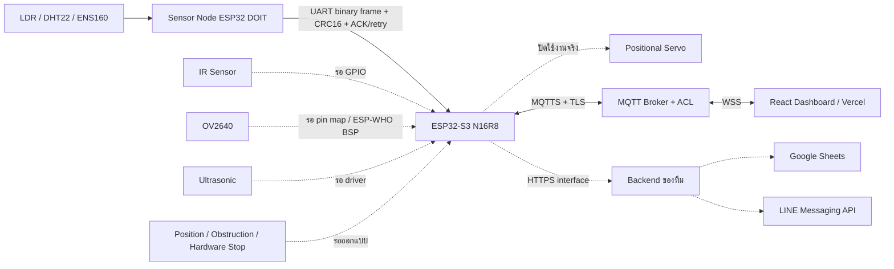

# ผังการเชื่อมต่อ: ยังไม่กำหนด GPIO จริง

ไฟล์ค่าขาคือ `gateway/include/pins.h` ทั้งหมดเป็น -1 และ driver จริงยัง disabled การกรอกเลขขาอย่างเดียวไม่ได้เปิด actuator รอบนี้ไม่มี environment สำหรับ real hardware

| สัญญาณ | ขาใน source | สิ่งที่ต้องยืนยัน |
|---|---|---|
| UART Sensor Node TX/RX | 17 / 18 | Node TX (GPIO17) → Gateway RX (GPIO18), Node RX (GPIO16) ← Gateway TX (GPIO17), Node RX ← Gateway TX, baud และ common GND |
| IR input | -1 | active level, pull-up/down, voltage, ISR edge |
| Ultrasonic trigger/echo | -1 / -1 | รุ่นจริงและโหมด US-100, logic voltage/level shifting |
| Servo PWM | -1 | รุ่น, supply แยก, common ground, pulse range, กลไก, กำลัง/แรงบิด |
| Hardware Stop | -1 | วงจรตัดการเคลื่อนที่ที่ไม่พึ่งเว็บ/เครือข่าย และ polarity |
| Open/Closed feedback | -1 / -1 | เซนเซอร์ยืนยันตำแหน่ง ไม่ใช้มุม servo เป็นหลักฐาน |
| OV2640 | ไม่กำหนดทุกขา | D0–D7, PCLK, XCLK, VSYNC, HREF, SCCB, PWDN, RESET ตามโมดูลและ BSP |

N16R8 ใช้ Octal PSRAM จึงมีขาที่สงวนเพื่อ memory ต้องตรวจ GPIO35/36/37 และขา flash/PSRAM จาก [คู่มือ Espressif](https://documentation.espressif.com/api/resource/path/docs/projects/esp-dev-kits/en/latest/esp32s3/esp32-s3-devkitc-1/user_guide_v1.0.html) ก่อนใช้ ห้ามคัด pin map ของ S3-EYE มาเปิดใช้บน DevKitC-1 โดยไม่มี schematic

ก่อนต่ออุปกรณ์จริง ขอ schematic, รุ่นบอร์ด/ภาพฉลาก module, pin map ฉบับทีม, voltage ทุกสัญญาณ, servo power, feedback/interlock, วิธี local fault reset และเงื่อนไขหยุดฉุกเฉิน ตรวจด้วย multimeter/อุปกรณ์จำลองก่อน การ build ไม่ได้ตรวจความถูกต้องของสายจริง

Face Recognition ทำบนบอร์ดเท่านั้น ขณะนี้ interface คืน Unavailable และไม่มี capture จริง ไม่ส่งรูปหรือ embedding ไป Cloud หรือ browser โดยอัตโนมัติ ไม่มีการเปิดกล้องหรือ Servo เมื่อ build/upload ตามโหมดเริ่มต้น
